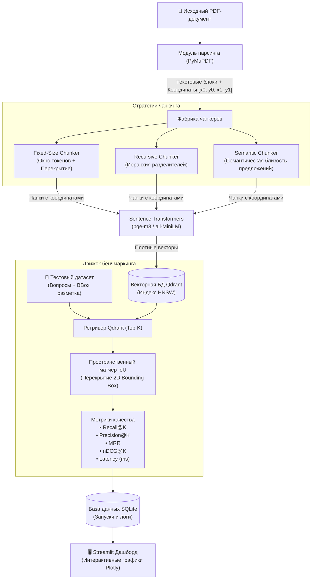

<h1 align="center">⚡ chunklab</h1>

<p align="center">
  Бенчмарк-система сравнения стратегий чанкинга PDF для RAG с пространственной 2D-оценкой и векторным поиском Qdrant
</p>

<p align="center">
  
  
  
  
  
</p>

---

## 📖 О проекте

В системах генерации с дополненной выборкой (RAG) **стратегия нарезки текста (чанкинга) — ключевой фактор**, определяющий качество ответов LLM. Неудачный чанкинг разрывает логические связи или перегружает контекст лишней информацией.

**ChunkLab** предоставляет исследовательскую среду для строгого сравнения стратегий нарезки документов в одинаковых условиях:
- **Пространственная оценка (Spatial Grounding)**: вместо неточного текстового совпадения релевантность оценивается по **Intersection over Union (IoU) 2D-координат** найденных фрагментов и истинной разметки в PDF.
- **Сравнение стратегий**: сопоставление **Fixed-Size**, **Recursive** и **Semantic** чанкинга на одинаковых моделях эмбеддингов и тестовых вопросах.
- **Интерактивный дашборд**: аналитическая панель на Streamlit и Plotly для инспекции фрагментов и сравнения метрик.

---

## 🏛 Архитектура



---

## ✨ Возможности

- 📐 **Точное извлечение координат из PDF**: сохранение страниц и 2D bounding box `[x0, y0, x1, y1]` для каждого фрагмента через PyMuPDF (`fitz`).
- 🧩 **3 стратегии сегментации**:
  - **Fixed-Size**: нарезка фиксированными окнами токенов с заданным шагом перекрытия.
  - **Recursive**: иерархический сплиттинг по параграфам, предложениям и словам.
  - **Semantic**: детекция тематических сдвигов на основе косинусного расстояния между эмбеддингами предложений.
- 🎯 **Объективная оценка по IoU**: исключение ложных срабатываний за счет проверки физического пересечения координат найденного чанка с правильным ответом на странице.
- 📊 **Полный набор метрик IR**:
  - **Recall@K** и **Precision@K**
  - **MRR (Mean Reciprocal Rank)**
  - **nDCG@K (Normalized Discounted Cumulative Gain)**
  - **Latency**: время выполнения запроса в миллисекундах
- 🖥️ **Современный веб-дашборд**: наглядные графики Plotly, инспектор найденных фрагментов и экспорт результатов в CSV и JSON.

---

## 🛠 Стек технологий

| Компонент | Технология | Назначение |
|---|---|---|
| **API & Backend** | FastAPI, Pydantic v2, Uvicorn | Асинхронный REST API сервис |
| **Интерфейс** | Streamlit, Plotly | Дашборд аналитики и визуализации |
| **Работа с PDF** | PyMuPDF (`fitz`) | Извлечение текста и пространственных 2D-координат |
| **Эмбеддинги** | Sentence-Transformers | Генерация векторных представлений |
| **Векторная БД** | Qdrant (`qdrant-client`) | Индексация и быстрый поиск по сходству (HNSW) |
| **Хранилище** | SQLite, SQLAlchemy 2.0 | Сохранение результатов экспериментов и логов |
| **Контейнеризация**| Docker, Docker Compose | Развертывание готового стека |

---

## 🚀 Быстрый старт

### 1. Клонирование репозитория
```bash
git clone https://github.com/egorfm/chunklab.git
cd chunklab
```

### 2. Виртуальное окружение и зависимости
```bash
python3 -m venv .venv
source .venv/bin/activate
pip install -r requirements.txt
cp .env.example .env
```

### 3. Запуск демо-данных (опционально)
```bash
python scripts/seed_demo_data.py
```

### 4. Локальный запуск сервисов

В первом терминале (Backend API):
```bash
uvicorn app.api.main:app --host 0.0.0.0 --port 8000 --reload
```

Во втором терминале (Streamlit UI):
```bash
streamlit run frontend/app.py --server.port 8501
```

- **Интерфейс Streamlit**: [http://localhost:8501](http://localhost:8501)
- **Документация Swagger API**: [http://localhost:8000/docs](http://localhost:8000/docs)

### 5. Запуск через Docker Compose
```bash
docker-compose up --build -d
```

---

## 🧪 Тестирование

```bash
pytest -v
```

---

## 📁 Структура проекта

```
chunklab/
├── app/
│   ├── api/           # Маршруты FastAPI эндпоинтов
│   ├── chunking/      # Реализация Fixed, Recursive и Semantic чанкеров
│   ├── evaluation/    # Расчет метрик и пространственного IoU
│   ├── extraction/    # Извлечение текста и координат через PyMuPDF
│   ├── retrieval/     # Интеграция с Qdrant и генерация эмбеддингов
│   └── storage/       # Модели SQLAlchemy и работа с базой данных
├── frontend/          # Дашборд на базе Streamlit и Plotly
├── scripts/           # Скрипты генерации демонстрационных данных
├── tests/             # Модульные и интеграционные тесты
├── docker-compose.yml # Конфигурация контейнеризации
├── requirements.txt   # Список зависимостей
├── LICENSE            # Лицензия MIT
└── README.md          # Документация проекта
```

---

## 📄 Лицензия

Проект распространяется под лицензией [MIT](LICENSE).
