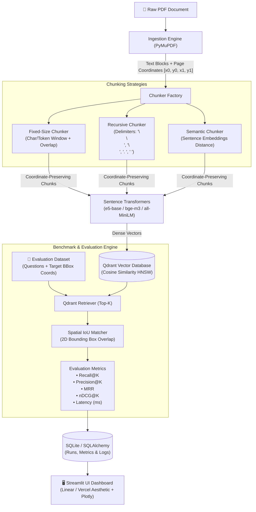

<div align="center">

# ⚡ ChunkLab

**PDF Chunking & Retrieval Benchmark System**

*An empirical evaluation and benchmarking suite for comparing PDF chunking strategies (Fixed, Recursive, Semantic) grounded on 2D bounding box spatial coordinates and Qdrant vector retrieval.*

[](https://www.python.org/downloads/)
[](https://fastapi.tiangolo.com)
[](https://streamlit.io)
[](https://qdrant.tech)
[](https://pymupdf.readthedocs.io/)
[](https://opensource.org/licenses/MIT)

</div>

---

## 📖 Overview

In Retrieval-Augmented Generation (RAG) systems, **chunking strategy is the single most critical upstream factor** governing retrieval quality. Suboptimal chunking leads to severed syntactic dependencies, diluted semantic embeddings, or irrelevant context flooding the LLM.

**ChunkLab** provides an end-to-end framework to scientifically compare chunking strategies under identical conditions:
- **Spatial Grounding**: Unlike crude string matching, ChunkLab assesses relevance by computing **2D Bounding Box Intersection over Union (IoU)** between retrieved passages and ground-truth document coordinates.
- **Fair Multi-Strategy Benchmarking**: Compares **Fixed-size**, **Recursive Delimiter-based**, and **Semantic Distance-based** chunkers on identical embedding models, Top-K settings, and test queries.
- **Production-Ready Stack**: Built with FastAPI, PyMuPDF, Sentence Transformers, Qdrant, SQLAlchemy, Plotly, and a Linear/Vercel-inspired Streamlit dashboard.

---

## 🏛 Architecture



---

## ✨ Key Features

1. **PDF Text & Coordinate Extraction**:
   - High-fidelity extraction via **PyMuPDF (`fitz`)**.
   - Preserves exact page numbers and 2D bounding boxes `[x0, y0, x1, y1]` for every text block and word span.

2. **Three Core Chunking Strategies**:
   - **Fixed-Size**: Slotted character/token windows with sliding overlap.
   - **Recursive**: Delimiter-hierarchy text splitting (`\n\n`, `\n`, `. `, ` `) maintaining semantic units.
   - **Semantic**: Calculates cosine distance between consecutive sentence embeddings and triggers splits when topic shifts exceed an adaptive similarity threshold.

3. **Spatial Coordinate-Grounded Evaluation**:
   - Evaluates passage relevance by calculating 2D bounding box **Intersection over Union (IoU)** and target coverage against ground truth annotations on the source PDF.
   - Eliminates false positives from repetitive keywords.

4. **Comprehensive Metric Suite**:
   - **Recall@K**: Proportion of ground truth relevant passages retrieved in the top $K$.
   - **Precision@K**: Density of relevant passages among the top $K$.
   - **MRR (Mean Reciprocal Rank)**: Reciprocal rank of the first relevant chunk ($1/\text{rank}$).
   - **nDCG@K**: Normalized Discounted Cumulative Gain accounting for rank positions.
   - **Retrieval Latency**: Query execution time in milliseconds.
   - **Chunk Profile**: Total chunks generated and average character length.

5. **Linear / Vercel-Style Streamlit Dashboard**:
   - Dark-mode minimalist dashboard with reactive metric cards.
   - Interactive **Plotly** visualizations (grouped metric bars, latency vs. recall trade-offs, chunk distributions).
   - **Retrieved Fragment Inspector**: Side-by-side inspection of chunks, rank scores, page badges, bounding boxes, and ground-truth match statuses.
   - One-click **CSV and JSON export**.

---

## 🛠 Technology Stack

| Layer | Technology | Purpose |
| :--- | :--- | :--- |
| **Backend & API** | FastAPI, Pydantic v2, Uvicorn | REST API, async request lifecycle |
| **Frontend UI** | Streamlit, Plotly | Modern dark-themed dashboard & interactive analytics |
| **PDF Extraction** | PyMuPDF (`fitz`) | Text block, word span & 2D coordinate extraction |
| **Chunking** | Custom Coordinate Chunker + LangChain Splitters | Fixed, Recursive, and Semantic text segmentation |
| **Embeddings** | Sentence-Transformers, PyTorch | Dense representations (`all-MiniLM-L6-v2`, `bge-m3`, `e5-base`) |
| **Vector Database** | Qdrant (`qdrant-client`) | Cosine similarity HNSW index (local disk / in-memory / container) |
| **Relational DB** | SQLite, SQLAlchemy 2.0 | Experiments, datasets, runs, and query retrieval logs |
| **Containerization**| Docker, Docker Compose | Multi-container production deployment |
| **Testing** | Pytest, Pytest-Asyncio, HTTPX | Unit and end-to-end integration test suites |

---

## 🚀 Quick Start Guide

### Prerequisites
- Python 3.12+
- Git

### 1. Clone the Repository
```bash
git clone https://github.com/egorfm/chunklab.git
cd chunklab
```

### 2. Set Up Virtual Environment & Dependencies
```bash
python3 -m venv .venv
source .venv/bin/activate
pip install -r requirements.txt
```

### 3. Configure Environment Variables
```bash
cp .env.example .env
```

### 4. (Optional) Seed Demo Benchmark Data
Populate the database with a pre-configured multi-page RAG whitepaper and gold-standard evaluation set:
```bash
python scripts/seed_demo_data.py
```

### 5. Start the Services

#### Option A: Local Development
Terminal 1 (Backend API):
```bash
uvicorn app.api.main:app --host 0.0.0.0 --port 8000 --reload
```

Terminal 2 (Streamlit UI):
```bash
streamlit run frontend/app.py --server.port 8501
```

- Open **Streamlit Dashboard**: [http://localhost:8501](http://localhost:8501)
- Open **FastAPI Interactive Docs**: [http://localhost:8000/docs](http://localhost:8000/docs)

#### Option B: Docker Compose
Run the complete stack (Qdrant + FastAPI Backend + Streamlit Frontend) in Docker:
```bash
docker-compose up --build -d
```

---

## 🧪 Running Tests

The test suite validates PDF coordinate extraction, chunking algorithms, Qdrant indexing, spatial IoU evaluation, and full REST API workflows:

```bash
pytest -v
```

All 13 integration and unit tests pass in seconds with zero external network dependencies.

---

## 📐 Benchmark Evaluation Methodology

### 1. Bounding Box IoU Relevance
Given a retrieved chunk bounding box $B_{ret} = [x_0, y_0, x_1, y_1]$ and a ground-truth annotation $B_{gt} = [x_0^*, y_0^*, x_1^*, y_1^*]$ on page $P$:

$$\text{IoU}(B_{ret}, B_{gt}) = \frac{\text{Area}(B_{ret} \cap B_{gt})}{\text{Area}(B_{ret} \cup B_{gt})}$$

Passage is marked **relevant** if:
$$P_{ret} = P_{gt} \quad \text{and} \quad \left( \text{IoU} \ge \tau \quad \text{or} \quad \frac{\text{Area}(B_{ret} \cap B_{gt})}{\text{Area}(B_{gt})} \ge \tau_{\text{containment}} \right)$$

### 2. Fair Benchmark Protocol
To ensure fairness:
1. Every strategy indexes the identical source document.
2. The exact same queries and ground-truth targets are tested across all runs.
3. The embedding model (`sentence-transformers/all-MiniLM-L6-v2` or `BAAI/bge-m3`) and Top-K parameters are held constant.

---

## 📡 API Endpoints

| Method | Endpoint | Description |
| :--- | :--- | :--- |
| `GET` | `/health` | Service health status |
| `POST` | `/api/documents/upload` | Upload PDF and extract text + coordinates |
| `GET` | `/api/documents` | List uploaded documents |
| `GET` | `/api/documents/{id}` | Get document metadata and sample blocks |
| `POST` | `/api/documents/{id}/preview-chunks`| Preview chunking results in real time |
| `POST` | `/api/datasets` | Create evaluation dataset with QA coordinates |
| `GET` | `/api/datasets` | List benchmark datasets |
| `POST` | `/api/experiments/run` | Execute comparative benchmark across strategies |
| `GET` | `/api/experiments` | List all experiments and metrics |
| `GET` | `/api/experiments/{id}` | Get detailed experiment run with retrieval logs |
| `GET` | `/api/experiments/{id}/export/json`| Export experiment metrics and logs as JSON |
| `GET` | `/api/experiments/{id}/export/csv` | Export high-level strategy comparison as CSV |

---

## 📄 License

This project is licensed under the MIT License — see the [LICENSE](LICENSE) file for details.
